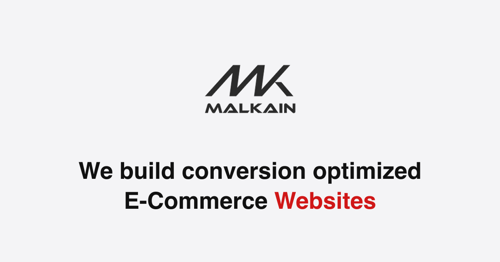

<p align="center">
  
</p>

# Malkain

Next.js site for [malkain.com](https://www.malkain.com), including the ad landing pages at `/landing/<slug>`.

## Run

```bash
npm install
npm run dev
```

## Environment

| Variable | Used for |
|---|---|
| `NEXT_PUBLIC_GOOGLE_ANALYTICS_ID` | Google Tag Manager |
| `NEXT_PUBLIC_META_PIXED_ID` | Meta pixel |
| `NEXT_PUBLIC_BING_CLARITY_ID` | Microsoft Clarity |
| `PUBLIC_EMAIL_ID`, `PUBLIC_EMAIL_ID_KEY` | SMTP login for the contact forms |

## Landing pages

Each `/landing/<slug>` page loads its content from the Firestore `pages` collection (`page_name` = slug). New pages are new documents; the template and past-work section are shared.
